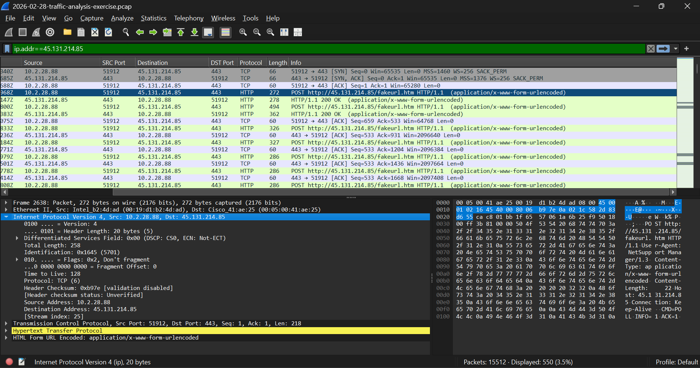
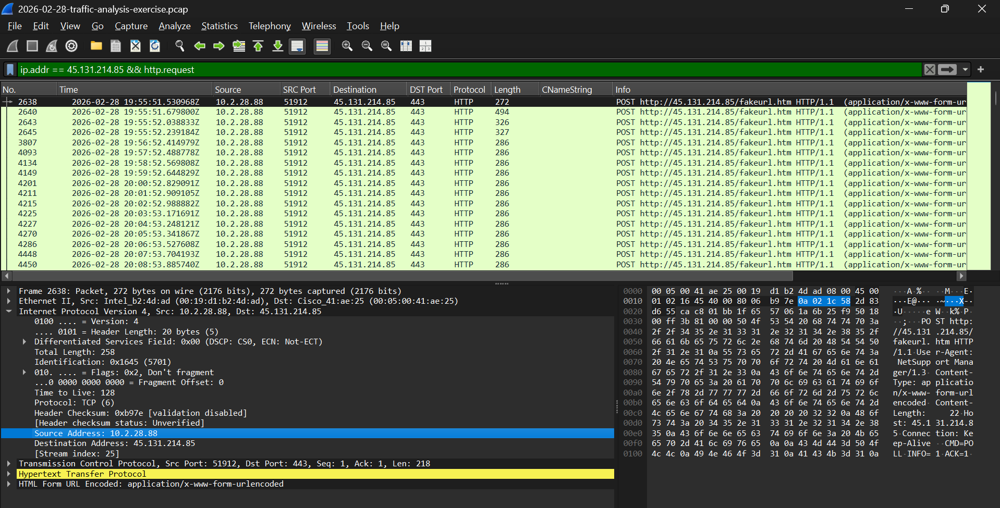
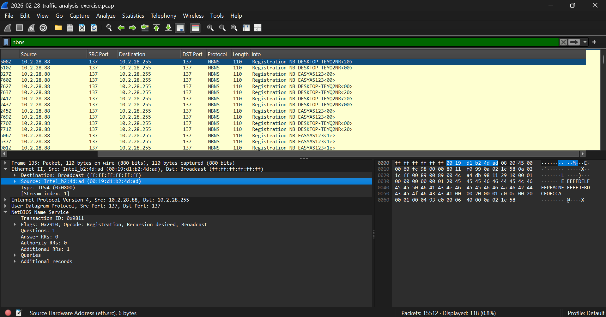
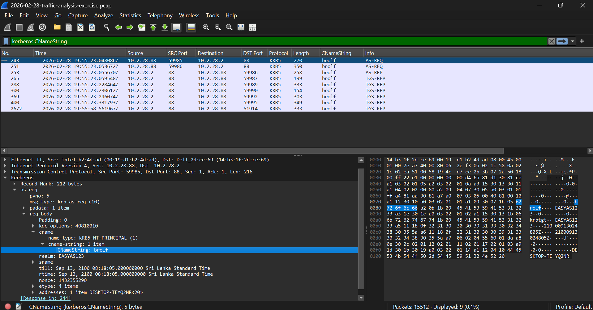
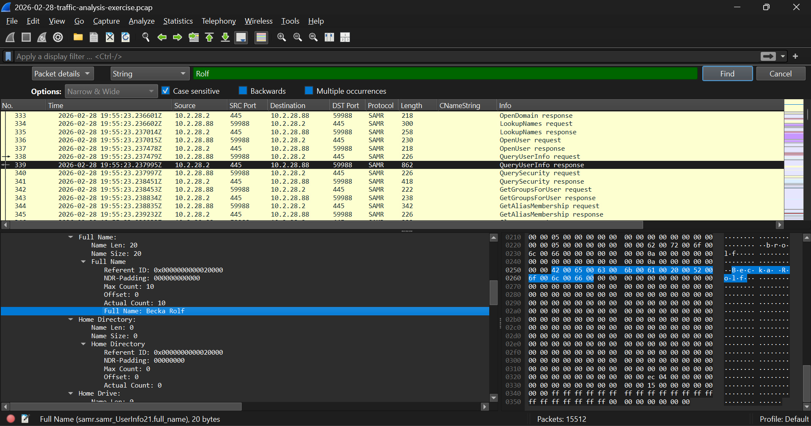

# Case 01: NetSupport RAT Infection (Network Traffic Analysis)

In this case I investigated a packet capture (`.pcap`) from a computer infected with a Remote Access Trojan (RAT). I used Wireshark and worked like an associate SOC analyst: I started with **one clue** from a SIEM alert and followed it step by step until I knew which computer was infected, who was using it, and how the malware was talking to the attacker.

**Exercise source:** [Malware-Traffic-Analysis.net, 2026-02-28 traffic analysis exercise](https://www.malware-traffic-analysis.net/2026/02/28/index.html). The scenario and the capture come from the exercise. My investigation steps, reasoning, report, detection ideas and recommendations are my own write-up.

---

## Quick terms

| Term | Meaning |
| :--- | :--- |
| **PCAP** | A file with recorded network packets. |
| **SIEM** | A tool that collects logs and raises alerts for analysts. |
| **RAT** | Remote Access Trojan: malware that lets an attacker control a computer remotely. |
| **C2 (Command and Control)** | The attacker's server that the infected computer talks to. |
| **IOC** | Indicator of Compromise: evidence of an attack, like an IP address or a User-Agent. |
| **NBNS** | NetBIOS Name Service: a Windows computer announces its name on the local network. |
| **Kerberos** | The login protocol used in Windows domains. Ticket requests contain the account name. |
| **SAMR** | A protocol Windows uses to ask the domain controller for user account details. |

---

## The scenario

My SIEM raised several alerts for **NetSupport Manager RAT** traffic going to `45.131.214[.]85` on TCP port 443, starting around 19:55 UTC on 2026-02-28. I was given a capture of the traffic from the internal computer that triggered the alerts.

**My job:** write an incident report that says which computer is infected, so someone can find it and stop the attack. I needed to find:
- the IP address of the infected computer
- its MAC address
- its hostname
- the user account name
- the full name of the user

---

## How I approached it: pivoting from one clue

The capture has **15,512 packets**, so looking through it packet by packet makes no sense. Instead I used the one solid clue I had (the C2 IP address) and let each answer give me the next thing to search for:

```
C2 IP address  ->  infected host IP  ->  hostname + MAC  ->  user account  ->  full name
```

Each filter made the list smaller, which kept the investigation focused:

| Step | Filter | Packets shown |
| :--- | :--- | :--- |
| 1 | `ip.addr == 45.131.214[.]85` | 550 of 15,512 |
| 3 | `nbns` | 118 |
| 4 | `kerberos.CNameString` | 9 |

---

## Environment

| Item | Details |
| :--- | :--- |
| Tool | Wireshark |
| Network | `10.2.28[.]0/24` |
| Domain | `easyas123[.]tech` (AD name `EASYAS123`) |
| Domain controller | `10.2.28[.]2` (`EASYAS123-DC`) |
| C2 server | `45.131.214[.]85:443` |

---

## Investigation, step by step

### Step 1: Find the infected computer's IP address
- **Filter:** `ip.addr == 45.131.214[.]85`
- **What I did:** I filtered for all traffic to and from the C2 address from the alert.
- **What I saw:** Only one internal computer was talking to it: `10.2.28[.]88`. It always started the connection, and the C2 server answered.
- **Result:** The infected computer is **`10.2.28[.]88`**.



### Step 2: Check that this really looks like NetSupport RAT
- **What I did:** I opened one of the HTTP packets (frame 2638) and looked at the packet details and bytes.
- **What I saw:**
  - The request is `POST http://45.131.214.85/fakeurl.htm`.
  - The User-Agent is `NetSupport Manager/1.3`.
  - The body contains short commands like `CMD=POLL`, `INFO=1` and `ACK=1`.
  - The connection uses `Keep-Alive`.
- **Why it matters:** The traffic goes to port 443, which normally carries encrypted HTTPS. But right after the TCP handshake there is a plain-text HTTP POST and **no TLS handshake**. Plain HTTP on port 443 is unusual and stands out. NetSupport Manager is a real remote administration tool, and attackers misuse it as a RAT.
- **Beaconing:** The POST requests repeat about **once every minute** (for example 19:55:52, 19:56:52, 19:57:52). A regular repeating "check-in" like this is called a beacon.



### Step 3: Find the hostname and MAC address
- **Filter:** `nbns`
- **What I did:** I filtered NetBIOS Name Service packets from `10.2.28[.]88`. Windows computers announce their name when they join a network. Then I opened the Ethernet II section of a packet to see the MAC address.
- **Results:**
  - **Hostname:** `DESKTOP-TEYQ2NR`
  - **MAC address:** `00:19:d1:b2:4d:ad`



### Step 4: Find the user account name
- **Filter:** `kerberos.CNameString`
- **What I did:** This is a Windows domain, so users log in with Kerberos. The ticket requests from `10.2.28[.]88` to the domain controller contain the account name in the `CNameString` field. The packet also lists `DESKTOP-TEYQ2NR<20>` as the address, which confirms the hostname from Step 3.
- **Result:** The user account is **`brolf`**.



### Step 5: Find the user's full name
- **What I did:** The username looks like a first initial plus a last name: `b` + `rolf`. I used **Edit > Find Packet**, searched the packet details for the case-sensitive string `Rolf`, and found a SAMR response from the domain controller. SAMR is how the computer asks the domain controller for details about the user, and in this capture the answer is not encrypted. The field is `samr.samr_UserInfo21.full_name`.
- **Result:** The full name is **Becka Rolf**.



---

## Results (IOCs)

IP addresses are written with `[.]` so they cannot be clicked by accident.

| Item | Value | How I found it |
| :--- | :--- | :--- |
| Infected host IP | `10.2.28[.]88` | Pivot from the C2 IP (`ip.addr`) |
| MAC address | `00:19:d1:b2:4d:ad` | Ethernet II layer |
| Hostname | `DESKTOP-TEYQ2NR` | NetBIOS (`nbns`) |
| User account | `brolf` | Kerberos (`CNameString`) |
| Full name | `Becka Rolf` | SAMR response |
| C2 server | `45.131.214[.]85:443` | SIEM alert, confirmed in the capture |
| URL path | `/fakeurl.htm` | HTTP POST requests |
| User-Agent | `NetSupport Manager/1.3` | HTTP headers |
| Beacon interval | About 60 seconds | Packet timestamps |

---

## Timeline (UTC, from the capture)

| Time | Event |
| :--- | :--- |
| 19:55:11 | Host announces its name on the network (NBNS) |
| 19:55:23 | Domain login traffic (Kerberos) and user lookup (SAMR) |
| 19:55:51 | First HTTP POST to the C2 server |
| After that | A POST about every minute |

The C2 traffic starts less than a minute after the user's login traffic, so the RAT seems to start working right after the computer starts up and the user logs in.

---

## MITRE ATT&CK mapping

| Technique | ID | What I saw |
| :--- | :--- | :--- |
| Application Layer Protocol: Web Protocols | T1071.001 | HTTP POST requests used as C2 check-ins |
| Non-Standard Port | T1571 | Plain HTTP sent over port 443 |
| Remote Access Software | T1219 | NetSupport Manager used for remote control |

---

## What I could not tell from this capture

- **How the computer got infected.** The capture starts after the infection, so I cannot see the email, download or website that caused it.
- **What the attacker did.** I can see the check-ins but not the attacker's actions or any stolen data.
- **If other computers are infected.** The capture comes from one host only.

---

## Recommendations

**Contain now**
1. Isolate `10.2.28[.]88` (MAC `00:19:d1:b2:4d:ad`) from the network.
2. Block `45.131.214[.]85` at the firewall.
3. Reset the password for `brolf` and review the account's recent logins.

**Follow up**
4. Search the SIEM and firewall logs for other computers contacting `45.131.214[.]85`, using the User-Agent `NetSupport Manager/1.3`, or posting to `/fakeurl.htm`.
5. Check the computer for persistence (startup entries, services, NetSupport files), then re-image it if needed.
6. Find out how the infection started, for example by checking email and browser history.

**Detection ideas**
- Alert on HTTP traffic on port 443 that has no TLS handshake.
- Alert on the User-Agent `NetSupport Manager`.
- Alert on an internal host sending repeated POSTs to the same external IP at regular intervals.

---

## What I learned

- Starting with one reliable indicator and pivoting is faster than searching a big capture randomly.
- Normal Windows network traffic (NetBIOS, Kerberos, SAMR) can reveal the hostname, username and full name of a victim.
- Port numbers can be misleading. Port 443 does not guarantee encrypted HTTPS, so I should check what is actually inside the packets.
- A regular beat in the timestamps is a strong sign of malware beaconing.

---

## References

- [Exercise page: Malware-Traffic-Analysis.net, 2026-02-28](https://www.malware-traffic-analysis.net/2026/02/28/index.html)
- [MITRE ATT&CK](https://attack.mitre.org/)
